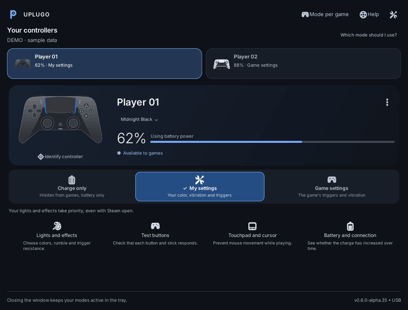

<p align="center">
  
</p>

# Uplugo

English · [Português](README.pt-BR.md) · [Español](docs/quickstart.es.md)

Uplugo is a Linux app for using and charging DualSense controllers over USB.
For each controller you decide who controls the lights, rumble and adaptive
triggers: you or the game. It also keeps an eye on the battery and lives in the tray.

<p align="center">
  
</p>

## Three modes

| Mode | What happens |
| --- | --- |
| **My settings** | Games see a virtual DualSense. Your light color, rumble and trigger resistance win, even with Steam open. |
| **Game settings** | Games and Steam talk to the physical controller and use its native features. |
| **Charge only** | The controller is hidden from games, effects are off and the battery keeps being read. |

Switching asks for confirmation, and a mode only shows as active after the
controller answers. Each controller keeps its own name, look and mode, even on
another USB port.

## What else it does

- **Test buttons:** a diagram that lights up buttons, sticks, triggers and touchpad touches.
- **Stick drift check:** a short guided test for resting position and range.
- **Motion:** live gyroscope and accelerometer graphs.
- **Battery:** charge history, so you can see whether it is actually charging.
- **Per-game mode:** optionally switch to Game settings while a chosen game is open.
- **Open at login:** starts in the tray, off by default.
- **Languages:** English, Português and Español, with GTK high-contrast support.

## Install

Use a USB **data** cable. Charge-only cables don't carry inputs.

Ubuntu or Debian:

```sh
sudo apt install python3 python3-gi gir1.2-gtk-3.0 librsvg2-common libusb-1.0-0 libayatana-appindicator3-1 pkexec udev ca-certificates
```

Fedora 44 (experimental):

```sh
sudo dnf install python3 python3-gobject gobject-introspection gtk3 librsvg2 libusb1 libayatana-appindicator-gtk3 polkit systemd-udev ca-certificates
```

Then, from the project folder:

```sh
python3 doctor.py --no-session   # checks dependencies
python3 setup.py                 # install, update or uninstall for your account
```

Open **Uplugo** from the applications menu and choose **Set up access**. The
desktop asks once for your password to install a small USB helper; the app
itself always runs as your normal user. The [quick start](docs/quickstart.en.md)
covers updates, uninstalling and every screen in detail.

## Photos

The app ships with its own controller illustrations. Want real photos? Add a
picture of your own controller in **Photo library**, or turn on
**Preferences → Controller photos → Download photos automatically** to fetch the
official catalog photos from Sony's servers. That download is **off by default**,
the photos stay on your computer and they are not part of this project.

## Status

Alpha. Tested on real hardware with the standard DualSense on Ubuntu. The
DualSense Edge and other distributions and desktops still need real-world
testing, so reports from other setups are very welcome.

## Found a bug?

Open **Preferences → Report a problem**. Uplugo opens a GitHub issue with the
version, your system and a diagnostics report already filled in (no names,
serial numbers or personal paths), and copies the full report to the clipboard.
You review everything before sending. You can also
[open an issue](https://github.com/importedunat/uplugo/issues/new/choose) directly.

## Development

```sh
python3 -m unittest discover -q        # unit tests
python3 tests/run_userspace.py         # full suite, needs xvfb-run and dbus-run-session
python3 development.py                 # offline lab with simulated controllers
```

Architecture, packaging and release notes live in [`docs/`](docs/). See
[CONTRIBUTING.md](CONTRIBUTING.md) before sending changes.

## License

Code and original artwork: GPL-3.0-only. The controller outline comes from
[dualshock-tools](https://github.com/dualshock-tools/dualshock-tools.github.io)
under the MIT license; details in [THIRD_PARTY.md](THIRD_PARTY.md).

Uplugo is an independent project and is not affiliated with Sony Interactive
Entertainment. DualSense and PlayStation are trademarks of Sony Interactive
Entertainment, used here only to describe compatibility.
