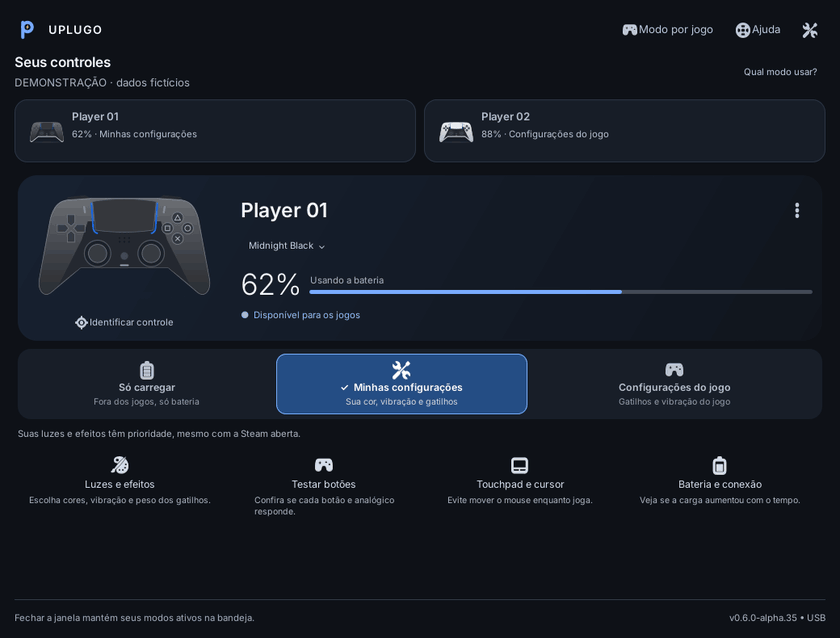
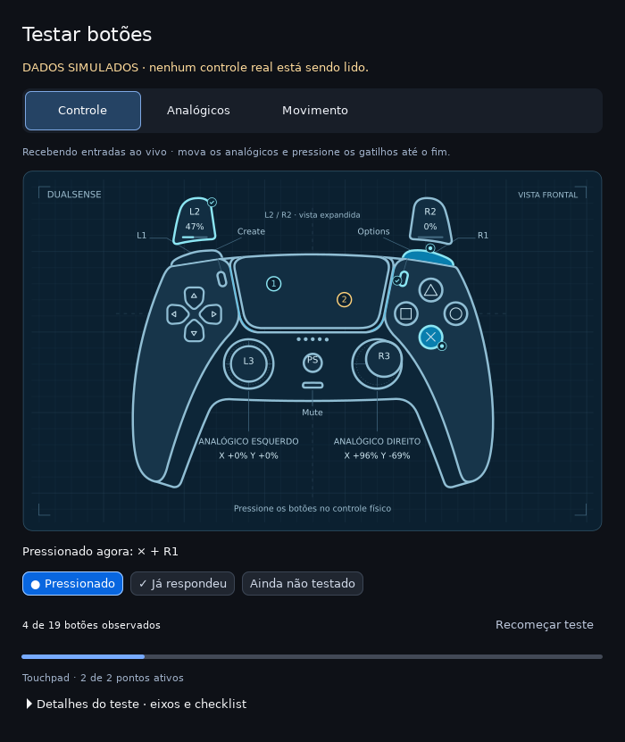
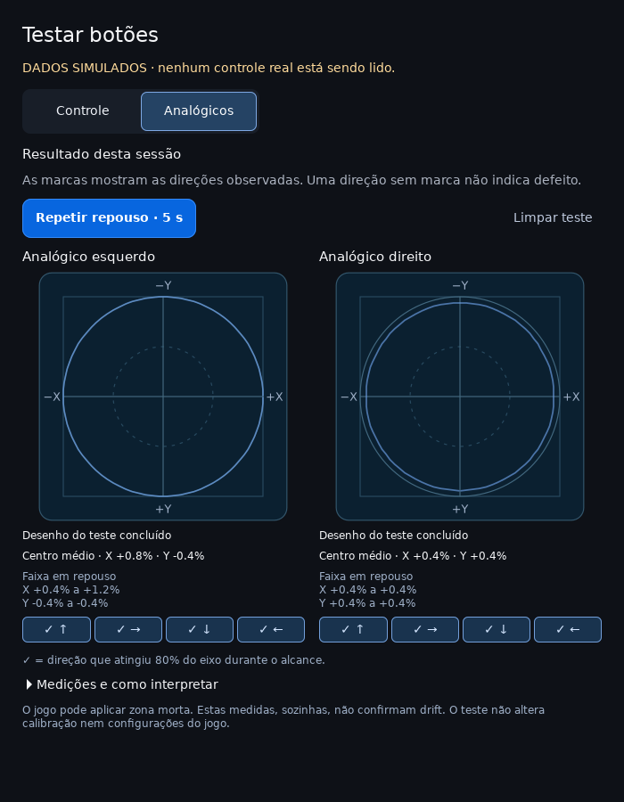
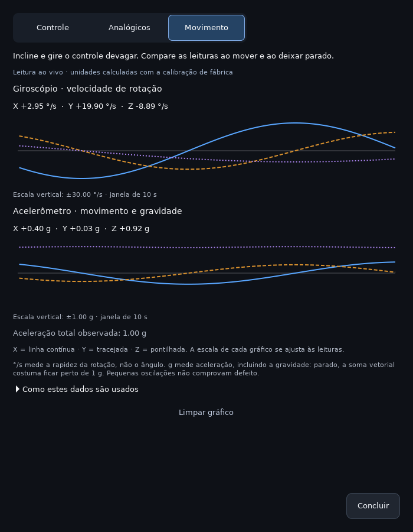
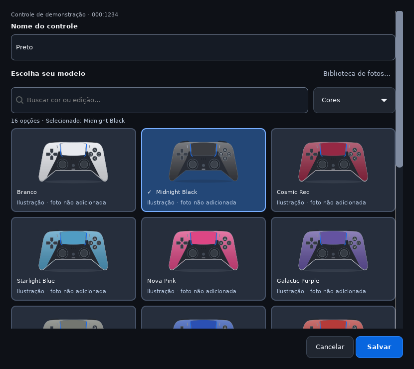
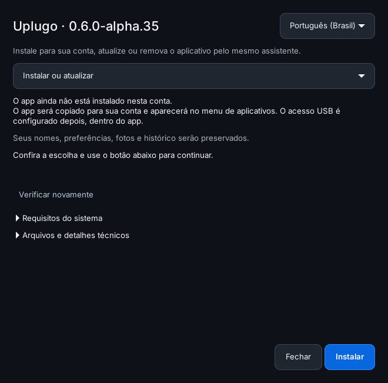
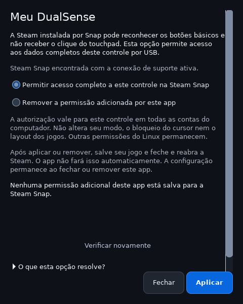
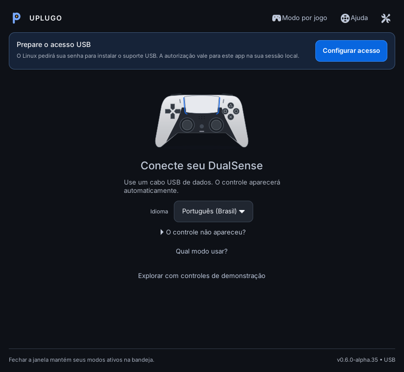

<p align="center">
  
</p>

# Uplugo

[English](README.md) · Português (Brasil) · [Español](docs/quickstart.es.md)

Um app independente para usar e carregar controles DualSense por USB no Linux.
Escolha quem controla os efeitos, acompanhe a bateria e mantenha tudo na bandeja.

<p align="center">
  
</p>

[Janela compacta](docs/compact-preview.png) · [Alto contraste](docs/high-contrast-preview.png)

## Jogar ou carregar

Selecione um controle no topo. Na área dele, os três modos ficam visíveis. O ✓ marca o modo
confirmado. Clique em outro modo, confira a consequência e confirme:

| Escolha | O que acontece |
| --- | --- |
| **Minhas configurações** | Um DualSense virtual aparece nos jogos. Suas cores, vibração e resistência dos gatilhos têm prioridade. |
| **Configurações do jogo** | O jogo e a Steam acessam o controle físico e seus efeitos nativos. |
| **Só carregar** | O controle fica oculto dos jogos, com efeitos desligados e bateria acompanhada automaticamente. |

O estado só é confirmado após a resposta do controle. Cada um tem nome, aparência
(modelo e foto escolhidos na galeria) e modo próprios. As preferências acompanham a
identidade do controle, mesmo em outra porta USB.

Pelo teclado, use **Tab / Shift+Tab** para navegar e **Espaço** para acionar um
botão. Escolher outro modo abre a confirmação; **Esc** cancela e devolve o foco
ao modo escolhido. As ações informam o nome e um ID curto do controle aos
leitores de tela. Em Luzes e efeitos, a cor escolhida tem ✓, e as escolhas de
vibração e gatilhos têm rótulos e explicações associados. O conteúdo do diálogo
rola quando necessário, mantendo Cancelar e Salvar e aplicar disponíveis.

A janela principal reorganiza fotos e comandos quando fica estreita. A lista
inteira rola, incluindo avisos de configuração, e o foco acompanha o controle
escolhido. O texto acompanha a fonte e a escala de texto do GTK. Ao usar um tema
GTK de alto contraste, a interface usa as cores desse tema; no visual padrão,
mantém a identidade grafite e azul.

**Identificar controle** pisca suas luzes brancas. **Luzes e efeitos** oferece
cores, vibração e resistência de L2/R2 (leve, média, firme, desligada ou controlada
pelo jogo). A resistência não muda a sensibilidade dos botões. A comparação entre
sem resistência e **Firme** foi confirmada nos dois gatilhos de um DualSense padrão,
com a Steam aberta. Os demais níveis têm testes de protocolo, mas ainda precisam
de comparação física; isso não homologa todos os jogos nem o DualSense Edge.

Fechar mantém a bandeja. Se o desktop não oferece bandeja, o app minimiza a janela
e explica como encerrar em Preferências. Encerrar libera os controles.

Para o app abrir sozinho, marque **Preferências → Abrir ao ligar o computador**. Ao
entrar na sua conta, ele começa na bandeja (ou minimizado, sem bandeja) e mantém os
modos salvos dos controles. A opção cria um atalho em `~/.config/autostart`, que a
desinstalação remove; desmarcar também remove. Ela fica disponível no app instalado,
não numa cópia aberta direto da pasta do projeto.

## Testar botões



**Testar botões** mostra um blueprint frontal com o contorno do DualSense e os
comandos nas posições físicas. Os botões acendem, os analógicos se movimentam e
L2/R2 mostram seu curso em uma vista expandida acima dos ombros.
O touchpad mostra até dois pontos numerados enquanto você desliza os dedos; o
clique continua sendo um botão separado. **Detalhes do teste** abre os valores
numéricos dos eixos, as coordenadas dos toques e o checklist completo.
Azul significa pressionado agora; ✓ significa que já respondeu
nesta sessão. Um botão sem marca ainda não foi observado, não é diagnóstico de defeito.
O painel permite recomeçar e limpa valores ativos quando a leitura fica antiga.
O desenho vem no pacote e funciona offline; créditos e licença da geometria em
[THIRD_PARTY.md](THIRD_PARTY.md).

Em **Só carregar**, o teste continua exclusivo do app e não cria entrada para
Steam/jogos. Nos modos de jogo, eles continuam recebendo os comandos normalmente.
Abrir ou fechar o painel não muda o modo. A leitura adicional só funciona enquanto
o teste está aberto, fica na memória e não vai para arquivos nem diagnósticos.
Pontos de toque não ficam desenhados depois de soltar ou perder a leitura. O
painel não mede pressão nem diagnostica a saúde do touchpad. A leitura de dois
contatos foi validada com relatórios simulados; falta a conferência física.
Botões extras do Edge têm mapeamento de protocolo, mas ainda não foram
confirmados no hardware.

Ao atualizar de uma versão anterior, o primeiro teste oferece **Atualizar suporte
USB**. É necessária uma autorização administrativa para substituir o helper; o
uso diário mantém a autorização restrita existente.

### Repouso e alcance dos analógicos



Em **Testar botões → Analógicos**, selecione **Começar repouso · 5 s** e deixe
os dois analógicos soltos. Depois escolha **Medir alcance**, gire cada um até
as bordas e selecione **Ver resultado**. A tela mostra o centro médio, os menores
e maiores valores em repouso e o traçado dos movimentos recentes. Nos detalhes,
confira também o alcance recebido e a quantidade de leituras.

As marcas ✓ indicam direções que atingiram 80% do eixo durante o alcance;
não são uma nota de aprovação. O círculo é uma referência visual. A média perto
de zero pode esconder movimento, por isso a faixa em repouso também fica visível.
O jogo pode aplicar zona morta: estas medidas não confirmam drift nem mudam
calibração ou configurações do jogo.

Perder a leitura ou sair desta aba interrompe uma medição em andamento; voltar
não a reinicia sozinho. Um resultado já concluído fica congelado até limpar,
repetir ou fechar o teste. Sem entrada atual, ele é identificado como anterior.
São usadas até 30 atualizações por segundo, não todos os pacotes USB. Tudo fica
na memória. O roteiro foi validado com dados simulados; a comparação física
guiada ainda está pendente.

Em **Minhas configurações → Luzes e efeitos**, escolha o peso dos gatilhos e use
**Experimentar peso · 5 s** para comparar antes de salvar. Solte L2/R2 e aperte
novamente durante o teste. O ajuste salvo volta após cinco segundos, ao mudar a
seleção ou ao fechar a janela. **Salvar e aplicar** mantém a escolha. Em **Jogar
direto**, o jogo controla os gatilhos; em **Só carregar**, os efeitos ficam desligados.

### Movimento do controle

Em **Testar botões → Movimento**, incline e gire o controle para acompanhar
os três eixos do giroscópio (°/s) e do acelerômetro (g). Os gráficos guardam
os últimos dez segundos somente na memória; sair da aba ou perder a leitura
limpa o histórico. As unidades usam a calibração de fábrica, lida sem alterá-la.
Se ela não estiver disponível, a tela informa a ausência em vez de estimar valores.



°/s indica rapidez da rotação, não orientação. O acelerômetro inclui a gravidade:
a intensidade total costuma ficar perto de 1 g quando parado. A tela não mede
posição, latência ou suporte do jogo a mira por movimento. Pequenas oscilações
não comprovam defeito. Leituras de calibração e sensores foram obtidas de dois
DualSense padrão por USB; ainda falta comparar os eixos com movimentos guiados.

## Ajuda na tela

O botão **Ajuda** no topo inicia um percurso pelos controles da própria janela,
com destaque no item explicado, Anterior, Próximo e saída a qualquer momento.
O guia não troca modos nem aciona luzes, gatilhos ou vibração. Ele funciona nos
três idiomas, inclusive antes de conectar um controle.

## Modelos e fotos



Clique no nome do modelo abaixo da imagem, ou em **Nome e aparência**. A galeria
oferece busca, grupos de cores, edições especiais e DualSense Edge. A seleção fica
como rascunho até Salvar. O USB não informa a cor ou edição da carcaça; escolher
uma imagem não muda a identificação do hardware nem habilita recursos do Edge.
O campo de nome tem rótulo permanente. A galeria se reorganiza conforme a largura,
mantém a escolha ao filtrar e oferece **Limpar filtros** quando não há resultados.
**Salvar** fica disponível com um nome preenchido e uma mudança pendente;
**Cancelar** descarta nome e modelo em edição. Enter na busca não salva a ficha.
Se não for possível gravar, o rascunho continua aberto para tentar novamente.

**Fotos oficiais (opcional, desligado por padrão):** em **Preferências → Fotos
dos controles**, marque **Baixar fotos automaticamente** para o app buscar as
**41 fotos disponíveis** do catálogo direto dos servidores da Sony, em segundo
plano e só para uso no seu computador. Depois, elas funcionam sem internet.
Fotos que você mesmo adicionou nunca são substituídas.
Sem conexão, ou nos cinco modelos ainda sem foto, são usadas ilustrações próprias.

O pacote inclui essas ilustrações com o mesmo enquadramento. Fotos pessoais
PNG/JPEG/WebP podem ser adicionadas em **Nome e aparência → escolha um modelo →
Biblioteca de fotos → Adicionar ou substituir foto**, de preferência vistas
de frente com fundo branco ou transparente. A foto é salva ao confirmar
**Adicionar à biblioteca**; essa operação é separada do rascunho de nome/modelo.
Cancelar a edição do controle não remove uma foto adicionada à biblioteca.
A biblioteca é local, em
`$XDG_DATA_HOME/dualsense-usb/appearance-library/`, e é preservada nas atualizações.
A imagem é compartilhada pelos controles que usam o mesmo modelo. O download
automático não substitui fotos que você já adicionou.

Fotos oficiais mantêm seus direitos originais e **não são incluídas no Git nem
no pacote GPL**. O pacote contém apenas os endereços em `assets/photo-sources.json`.
Downloads não enviam nomes, identificadores ou leituras dos controles. Os servidores
das imagens recebem as requisições de rede e o endereço IP, como em outros downloads.
O renderizador ajusta escala e margens na tela sem alterar os arquivos originais.
A prévia pública ignora a biblioteca pessoal. Consulte [licenças e créditos](THIRD_PARTY.md).
O [estado do catálogo](docs/model-catalog.md) lista as versões e as fotos ainda pendentes.

## Instalar no Linux

Para distribuir uma cópia verificável, execute `python3 release.py build`.
O diretório `dist/` recebe um pacote de código-fonte alpha e seu SHA256, com
licenças, traduções e os arquivos necessários. O pacote é construído por uma
lista explícita, sem preferências ou fotos pessoais. Veja como
[conferir, extrair e instalar o pacote](docs/releasing.md).

Requer Python 3.10+, GTK 3/PyGObject, libusb, polkit, udev e uma sessão gráfica
com D-Bus. systemd de usuário é opcional. UHID é necessário para jogar com o controle virtual;
bandeja AppIndicator é opcional. Há testes físicos locais no Ubuntu/GNOME e
testes de instalação/interface isolados no Ubuntu 24.04, Debian 13 e Fedora 44.
Debian e Fedora ainda precisam de validação com sessão gráfica e USB reais; consulte a
[matriz de suporte](docs/linux-support.md).

### Ubuntu e Debian

```sh
sudo apt install python3 python3-gi gir1.2-gtk-3.0 librsvg2-common libusb-1.0-0 libayatana-appindicator3-1 pkexec udev ca-certificates
python3 setup.py
```

### Fedora 44 (experimental)

Para o Fedora tradicional com DNF:

```sh
sudo dnf install python3 python3-gobject gobject-introspection gtk3 librsvg2 libusb1 libayatana-appindicator-gtk3 polkit systemd-udev ca-certificates
python3 doctor.py --no-session
python3 setup.py
```

`gobject-introspection` é necessário mesmo com GTK e PyGObject instalados:
fornece tipos usados por GTK 3, incluindo `xlib-2.0`. A instalação mínima foi
testada com dependências opcionais do DNF desativadas. Silverblue, Kinoite,
permissões SELinux e o helper em uma sessão Fedora real ainda não foram validados.

### Abrir e atualizar

Na pasta extraída do download, `python3 setup.py` abre o assistente de
instalação e remoção em português, inglês ou espanhol. Ele mostra o destino,
confere os requisitos e explica o que será preservado. Depois de instalar,
clique em **Abrir app**. Python, PyGObject e GTK precisam estar instalados para
abrir essa janela; as dependências continuam sendo instaladas pelo gerenciador
de pacotes da distribuição. A alternativa pelo terminal é `python3 install.py`.

A alpha.21 também gera `.deb` e `.rpm` experimentais. Instalação, atualização,
recuperação e remoção passaram em APT/dpkg e DNF/RPM dentro de imagens descartáveis.
A autorização é por conta, e a manutenção é bloqueada enquanto o programa está
em execução. Os artefatos de validação ainda usam metadados fictícios e não são
releases públicas. Na abertura pelo menu, uma janela explica instalações incompletas
ou em manutenção e permite tentar abrir novamente após o reparo. O aviso acompanha
o idioma escolhido e funciona mesmo sem os arquivos visuais do app. O assistente
nativo já oferece migração com prévia, cópias da instalação antiga e retomada
após interrupção; consulte o [roteiro de migração](docs/maintenance.md).
Falta validar migração, autorização e USB em uma sessão gráfica real.
Veja a geração, os caminhos e os limites no [plano de instalação nativa](docs/native-packaging.md).

Se o touchpad mover o cursor ao jogar, abra o menu **⋮ → Touchpad e cursor**
daquele controle. A opção **Usar nos jogos, sem mover o cursor do Linux** salva
uma regra para esse controle no computador. Ela pede autorização administrativa
e oferece **Restaurar o comportamento padrão do Linux** na mesma tela.
Steam Input pode ter um mapeamento de mouse independente; confira a ajuda da
janela e [os limites do recurso](docs/linux-support.md#touchpad-e-steam).



Na instalação por usuário, se uma atualização for interrompida, a próxima abertura mostra **Recuperar
instalação**. O app restaura a versão anterior ou conclui a limpeza da nova,
preservando seus dados. Na primeira instalação, se ainda não houver atalho,
abra `python3 setup.py` na pasta do download e escolha **Recuperar instalação**.
Também existe `python3 install.py --recover` pelo terminal. Consulte o
[guia de recuperação](docs/maintenance.md#se-a-atualização-for-interrompida).


O app usa dependências do sistema, sem pip. O instalador copia o programa para
`~/.local/share/dualsense-usb/app`; o atalho não depende da pasta do download.
Para atualizar, encerre o app pela bandeja e execute `python3 setup.py` a partir
da nova versão. Escolha **Instalar ou atualizar**. O instalador bloqueia a troca enquanto o app estiver aberto.
Preferências e nomes são preservados. Não copie arquivos pessoais
para o diretório do código.
Abra **Uplugo** pelo menu e use **Configurar acesso** na primeira execução.
O sistema pede autorização para instalar o helper e suas regras. A interface
roda como seu usuário; apenas o helper restrito executa operações de hardware.
Não execute a interface com sudo. A regra polkit autoriza o helper fixo na sessão
local ativa do instalador; não libera comandos administrativos genéricos.
O app não é habilitado automaticamente no login.

Abrir novamente pelo menu mostra a sessão existente, inclusive quando a janela
está na bandeja, sem reiniciar os controles. Quando há systemd de usuário, ele
supervisiona o app e tenta recuperá-lo após falhas. Sem esse gerenciador, a janela
abre diretamente e continua na bandeja enquanto o processo estiver ativo; não
há reinício automático após uma falha. Polkit, udev e o gerenciamento de acesso
da sessão (logind ou equivalente) continuam necessários para o hardware.

Para remover, abra **Preferências → Ferramentas e manutenção → Instalação e remoção** ou `python3 setup.py`
na pasta do pacote. Escolha **Remover da minha conta**, encerre o app pela bandeja
e use **Verificar novamente**. O assistente mostra a quantidade e a lista de
arquivos antes de remover. Pelo terminal, `python3 uninstall.py` mostra a prévia
e `python3 uninstall.py --yes` aplica depois de encerrar o app. Nomes, fotos,
preferências e histórico permanecem. `--remove-access` inclui o helper e suas
regras, com autorização administrativa separada; no assistente, marque
**Remover também o suporte USB e suas permissões**. Veja o [guia de atualização e
remoção](docs/maintenance.md), incluindo instalações antigas e arquivos modificados.

Se o cursor já parou, mas o clique ainda não funciona na Steam instalada por
Snap, abra **Conferir acesso da Steam Snap** nessa mesma tela. A opção verifica
se essa instalação está disponível e permite adicionar ou remover uma permissão
específica para esse controle. **Aplicar** pede autorização; depois salve o jogo e
feche e reabra a Steam. Nenhum jogo ou controle é reiniciado automaticamente.
Permissões de outras ferramentas são preservadas. Isso não atribui uma função
ao touchpad no layout do jogo. A regra permanece após remover o app; use a opção
de remover a permissão antes, se quiser desfazer essa configuração.



## Primeira abertura



O app escolhe português, inglês ou espanhol a partir do idioma do sistema na
primeira abertura; usa inglês quando não há um idioma suportado. Uma escolha
manual salva sempre tem prioridade. Sem controles conectados, o seletor de
idioma fica visível na tela; ele também está em Preferências a qualquer momento.

**Configurar acesso** explica a autorização antes de abrir a janela de senha do
Linux. Cancelar mantém seus modos e preferências. Se a configuração falhar, a
tela oferece nova tentativa e detalhes técnicos que você pode expandir. O app
confere o suporte instalado antes de anunciar sucesso e retomar as sessões.
**Preferências → Acesso USB** permite revisar e atualizar esse suporte depois.

**Qual modo usar?** explica as três escolhas a partir do que você quer fazer,
incluindo orientações para jogos que não respondem. Ler a ajuda não muda modos
nem envia comandos ao controle. **O controle não apareceu?** orienta a conferir
conexão USB e cabo de dados. **Explorar com controles de demonstração** abre o
laboratório sem USB, que pode ser usado mesmo sem um controle conectado.

## Modo por jogo

Você pode jogar sem configurar esta tela. Ela serve para quem usa seus próprios
efeitos no app, mas prefere os efeitos nativos de determinados jogos.

A tela mostra o caminho do controle antes, durante e depois do jogo. A busca
filtra nomes sem desmarcar escolhas; Cancelar descarta o rascunho.

Esta opção é facultativa. Marque jogos no botão **Modo por jogo** quando
precisarem receber o DualSense diretamente. Ao abrir um jogo marcado, todos os
controles em **Minhas configurações** passam para **Configurações do jogo**. Suas preferências de
cores, vibração e peso dos gatilhos ficam pausadas enquanto a Steam e o jogo
controlam os efeitos. Ao fechar o jogo, o modo anterior e os ajustes retornam.
**Só carregar** permanece igual: esses controles continuam ocultos dos jogos.
A lista omite pacotes de suporte conhecidos, como Proton, Steam Linux Runtime
e Steamworks Common Redistributables. Não altera nem desinstala esses pacotes.

Em **Adicionar outro jogo (avançado)**, use um ID da Steam ou nome de arquivo
`jogo.exe`, um por linha. O ID é o número após `/app/` no endereço da página do
jogo na loja Steam. Sem jogos escolhidos, não há troca automática por jogo.
O app não detecta suporte nativo automaticamente nem altera configurações da Steam.

A troca reconecta o controle visto pelo jogo. Alguns jogos exigem **Configurações do jogo**
antes de abrir e Steam Input desativado nas propriedades do jogo.

A tela **Touchpad e cursor** inclui uma demonstração que responde ao arrastar
ou às setas do teclado. Ela é separada do estado atual no Linux e só explica a
escolha; aplicar a configuração continua sendo uma ação explícita.

Em **Bateria e conexão**, o gráfico mostra as leituras do período atual. Ele não
estima tempo restante nem a potência do cabo. Valores exatos e explicações
podem ser expandidos, e as anotações continuam disponíveis para comparar cabos.

## Idiomas

Escolha **Português (Brasil), English ou Español** em **Preferências → Idioma**.
A escolha é salva e atualiza a interface e a bandeja imediatamente, sem reiniciar
as sessões USB nem mudar os modos. Traduções vêm no pacote e funcionam offline.
Antes de uma escolha manual, `LANGUAGE` e o locale da sessão determinam o idioma
inicial. Variantes regionais usam o catálogo disponível, como espanhol para
`es_MX` e português brasileiro para `pt_PT`.
Nomes pessoais dos controles e títulos dos jogos permanecem como foram definidos.
Mensagens técnicas externas e controles nativos do sistema podem seguir o idioma
do sistema; o seletor não muda o idioma do Linux, Steam ou dos emuladores.

## PCSX2

O emulador precisa de um mapeamento próprio, mesmo quando já detecta o DualSense.
Em **Settings → Controllers**, habilite **SDL** e, em **Controller Port 1**, use
**Automatic Mapping** e escolha o DualSense disponível. Isso preenche os botões,
analógicos, gatilhos e motores conforme o [guia oficial do PCSX2](https://pcsx2.net/docs/configuration/controllers/).
O número SDL pode variar se outros controles forem conectados.

Se o jogador 1 aparecer ligado só ao teclado, refaça o mapeamento SDL. Em
**Minhas configurações**, o PCSX2 reconhece o controle virtual; botões e vibração
enviada pelo próprio jogo ainda não foram testados nesse modo.

## Limites

- A bateria é informada em passos aproximados de 10%, sem medição de corrente.
  Em **Bateria e conexão**, compare a observação atual e até 24 anteriores,
  com porta USB, horários e porcentagens. O histórico permanece neste computador;
  períodos sem leitura ficam separados. A variação pode incluir uso e carga:
  não mede velocidade do carregador nem identifica o cabo.
  Use **Anotar cabo e condições** para registrar, por exemplo, qual cabo e hub
  você usou naquele período. A anotação é manual, pode ser editada ou apagada,
  não passa para uma nova conexão e não entra no diagnóstico exportado.
  “Carregando” é o estado recebido, não prova de corrente entrando. Os
  detalhes mostram aumentos efetivamente observados. Leituras antigas são
  identificadas e não mantêm a animação de carga.
- Testado localmente com dois DualSense padrão por USB. O ID do Edge é reconhecido,
  mas esse modelo não foi testado fisicamente. Bluetooth não é suportado.
- O proxy preserva relatórios de botões, movimento e touchpad e filtra saídas HID.
  Áudio USB não é virtualizado. Para áudio/háptica nativa completa use **Jogar
  direto**; compatibilidade varia por jogo.
- Sem atualização de firmware ou escrita de calibração. O app não aumenta a
  corrente da porta nem corrige cabos ruins.

## Dados locais

Preferências: `$XDG_CONFIG_HOME/dualsense-usb/controllers.json`, por padrão
`~/.config/dualsense-usb/controllers.json`. Leituras e histórico:
`$XDG_STATE_HOME/dualsense-usb/`, por padrão `~/.local/state/dualsense-usb/`.
Arquivos do protótipo são migrados na primeira abertura; originais são preservados
como backup local e ignorados pelo Git. Não publique configurações, identificadores,
leituras, histórico ou diagnósticos pessoais. A prévia usa dados fictícios.

## Desenvolvimento

```sh
python3 build_helper.py
python3 -m unittest discover -v
python3 -m compileall -q .
python3 doctor.py
python3 tests/clean_install.py
python3 tests/release_smoke.py
python3 tests/gui_smoke.py
python3 tests/startup_smoke.py
python3 tests/first_use_smoke.py
dbus-run-session -- python3 tests/session_smoke.py
python3 tests/photos_smoke.py
python3 tests/effects_smoke.py
python3 tests/input_smoke.py
python3 tests/stress.py
python3 preview.py --output docs/preview.png
```

Os testes de protocolo não precisam de controles nem root. Os testes gráficos
e de instalação exigem as dependências do app; em CI usam Xvfb. A prévia precisa de sessão gráfica,
mas não abre USB. Cenários: dashboard, empty, stale, error e setup.
Também há cenários welcome, welcome-cancelled, welcome-failed e welcome-busy.
`--language en` ou `--language es` muda apenas a prévia. Para capturar uma janela
nativa em um display de teste:

```sh
xvfb-run -a python3 preview.py --native --scenario welcome --output docs/first-use.png
```

O build gera install-access.py com o helper incorporado e remove-access.py;
ambos são ignorados pelo Git. Alterações de protocolo exigem gerar e reinstalar o helper; alterações
apenas na interface exigem reiniciar o app.

Veja [arquitetura](docs/architecture.md), [compatibilidade Linux](docs/linux-support.md)
e [decisões de interface](docs/design.md).
O [plano de evolução](docs/roadmap.md) separa recursos implementados, validação
pendente e os próximos trabalhos para ampliar o suporte.

## Laboratório e diagnóstico

**Preferências → Ferramentas e manutenção → Desenvolvimento e diagnóstico**
mostra um resumo do ambiente e permite expandir o relatório antes de copiá-lo.
**Abrir laboratório sem USB** abre outra janela com controles fictícios, falha
de conexão, leitura antiga e desconexão. O laboratório também
pode ser iniciado com `python3 development.py`. Não abre USB, não baixa fotos,
não altera suas preferências e não exige root. A simulação inclui a troca de
modos, rascunhos de efeitos e o painel de botões.

O diagnóstico usa campos selecionados: versão, dependências, estados de conexão,
contadores do serviço e variação de bateria observada. Omite nomes, identidades,
portas, caminhos pessoais e botões. O relatório completo pode ser revisado antes de copiar; não existe
envio automático. Veja [desenvolvimento e dados](docs/development.md).

## Encontrou um problema?

Abra **Preferências → Relatar um problema**. O app abre o formulário do GitHub
já com a versão, o sistema e um diagnóstico sem dados pessoais, e copia o
diagnóstico completo. Você revisa tudo antes de enviar. Também dá para abrir
direto em [Issues](https://github.com/importedunat/uplugo/issues/new/choose).

## Licença

Código: **GNU GPL versão 3 somente (`GPL-3.0-only`)**, conforme [LICENSE](LICENSE).
Ilustrações SVG próprias seguem a mesma licença. Fotos da biblioteca pessoal
mantêm suas licenças originais; veja [THIRD_PARTY.md](THIRD_PARTY.md). Uso comercial do código é permitido;
a distribuição de versões modificadas do código mantém as obrigações da GPL.

Esta versão é experimental. A instalação administrativa em uma máquina limpa e
a matriz completa de distribuições ainda precisam de validação antes de anunciar
suporte amplo. O workflow prepara testes em Ubuntu 22.04, Ubuntu 24.04 e Debian 13,
com a mesma suíte local e relatórios por ambiente; sua execução no GitHub ocorre
após a publicação.

Projeto independente, sem afiliação à Sony ou à Valve. Os nomes DualSense,
PlayStation e Steam pertencem aos respectivos titulares.

## Proteção automática

Em Preferências, **Carregar ao detectar acesso de outro app** procura aplicativos
da sua sessão que mantêm aberto um dispositivo deste controle. Ao detectar acesso,
o app escolhe Só carregar e informa o motivo. A consulta ocorre a cada 2 segundos;
é possível haver entrada antes da detecção. Tentativas recusadas pelo sistema,
acessos muito breves e processos inacessíveis não podem ser observados por esse método.

**Permitir acesso quando eu clicar em Jogar** suspende a proteção para aquele
controle até você escolher Só carregar. Desativar essa exceção também bloqueia
os jogos e programas do desktop que abrem o controle. A proteção automática vem
desligada em uma instalação nova, para não interromper jogos inesperadamente.
A exclusividade do modo Só carregar continua valendo independentemente do detector.
