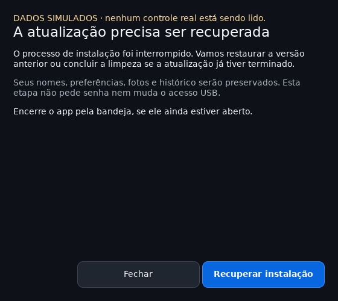

# Atualizar e remover

Esses comandos são executados na pasta extraída do pacote, como seu usuário.
Não use `sudo` no instalador nem na interface. O acesso administrativo ao USB
é uma etapa separada, com a janela de autorização do desktop.

## Quando a atualização muda o suporte USB

O app compara em segundo plano o serviço instalado com o incluído nesta versão.
Se forem diferentes, aparece **Revisar suporte USB**, sem pedir senha ou reiniciar
os controles. Isso também pode indicar uma versão mais recente ou uma alteração
local, não necessariamente uma versão antiga. A comparação é um aviso de versão,
não uma verificação de segurança ou da autorização da sua conta.

Nas instalações por usuário, o botão abre a explicação da atualização antes de
solicitar autorização. Nos pacotes da distribuição, **Verificar instalação** abre
o assistente; a substituição dos arquivos continua sendo feita pelo gerenciador
de pacotes. O aviso desaparece após a próxima verificação quando os arquivos
correspondem. Os modos de jogo e carga continuam disponíveis durante a comparação.

Na instalação por usuário, atualizar os arquivos do app não substitui sozinho
o serviço administrativo. Versões com mudanças nesse serviço, como a alpha.25,
também precisam de **Preferências → Acesso USB → Atualizar suporte USB** no app
atualizado. O sistema pode pedir autorização; as sessões dos controles são
reiniciadas e os modos salvos retomados. Faça isso fora de uma partida.

Em instalações `.deb`/`.rpm`, o helper pertence ao pacote e é atualizado pelo
gerenciador da distribuição. **Configurar acesso** autoriza a conta; não substitui
os arquivos do pacote por um instalador manual. Se o pacote estiver incompleto,
repare-o pelo gerenciador antes de configurar o acesso.

## Assistente gráfico

Depois de instalar as dependências indicadas no README, execute `python3 setup.py`
na pasta extraída. Na versão instalada, **Preferências → Ferramentas e manutenção → Instalação e remoção**
abre a mesma janela. Escolha instalar/atualizar ou remover; o assistente informa
o estado atual, os requisitos, os arquivos afetados e o que será preservado.
O idioma dessa janela pode ser escolhido sem alterar a preferência do app.


Encerre o app em **Preferências → Encerrar e liberar controles** ou pela bandeja,
mantendo o assistente aberto. Clique em **Verificar novamente** para continuar.
Fechar apenas a janela do app o mantém na bandeja. O assistente impede alterações
com o app ativo, solicita recuperação se houver uma atualização pendente e
permite tentar novamente após uma falha. Os detalhes técnicos ficam disponíveis
em uma seção expansível. Durante a alteração dos arquivos, aguarde a conclusão.

Na remoção, **Remover também o suporte USB e suas permissões** é opcional e vem
desmarcado. Essa opção pede autorização administrativa; cancelar essa autorização
interrompe a operação antes de remover os arquivos do app. Sem a opção, o suporte
USB permanece instalado para uso futuro. Nomes, fotos, preferências, histórico e
arquivos alterados/desconhecidos são preservados nos dois casos.

Instalar pelo assistente não abre o app automaticamente: ao terminar, clique em
**Abrir app**. O assistente informa que solicitou a abertura; isso não confirma
que a sessão USB já iniciou. Se a janela não aparecer, consulte
`$XDG_STATE_HOME/dualsense-usb/setup-launch.log` (por padrão,
`~/.local/state/dualsense-usb/setup-launch.log`). Os comandos abaixo continuam
disponíveis como alternativa ao assistente.

Quando aberto pelas Preferências, o assistente fica em um processo independente.
Com systemd de usuário, ganha um escopo próprio para continuar aberto depois de
encerrar o app principal. Se essa abertura falhar, a interface mostra uma
orientação; `setup-assistant.log`, na mesma pasta de estado citada acima, contém
o diagnóstico. Abrir `python3 setup.py` na pasta do download continua disponível.

## Passar da instalação por usuário para um pacote do sistema

Os pacotes `.deb` e `.rpm` ainda são experimentais. Depois de instalar um deles,
abra `/usr/bin/dualsense-usb --setup`: esse caminho evita o atalho antigo que pode
continuar aparecendo no menu. Encerre a instalação antiga pela bandeja e clique
em **Verificar novamente**. A prévia mostra os arquivos que serão guardados.

**Migrar para a versão do sistema** guarda a pasta antiga inteira, o atalho, o
ícone, a unidade de serviço e suas personalizações. Isso inclui arquivos
modificados ou desconhecidos e instalações antigas sem registro. A etapa usa
somente os arquivos da sua conta e não pede senha. Nomes, modos, fotos e histórico
permanecem nos locais atuais; dados que ainda estejam dentro da pasta antiga são
copiados somente quando o destino não existe. Preferências atuais não são trocadas.

As cópias ficam em pastas privadas `.dualsense-usb-before-system-<identificador>`
ao lado de cada local original. Assim, dados e configurações podem estar em
discos diferentes. Os caminhos aparecem nos detalhes; o registro durável fica em
`$XDG_DATA_HOME/dualsense-usb/migrations/` (normalmente
`~/.local/share/dualsense-usb/migrations/`). As cópias não são apagadas pelo app.

Se houver uma atualização antiga interrompida, primeiro use **Recuperar instalação
antiga**, confira a nova prévia e só então migre. Se a própria migração for
interrompida, abra novamente o assistente do sistema e use **Concluir migração**.
Arquivos alterados durante a operação são preservados para revisão; não apague
o registro `.migration-pending.json` nem as cópias enquanto houver pendência.

Ao terminar, **Abrir app** usa a versão do sistema, que possui sua própria
configuração de acesso USB. **Limpar suporte USB antigo (opcional)** é uma ação
administrativa separada: pede autorização e usa a verificação de propriedade do
instalador antigo. Cancelar mantém o suporte antigo. Essa limpeza não remove o
suporte nativo, as concessões nativas ou as cópias do programa anterior. Serviços
ativos não são encerrados automaticamente pela migração.

## Atualizar

1. Na bandeja, escolha **Sair e liberar controles para a Steam**. Sem bandeja,
   use a opção de encerrar em Preferências. Fechar a janela apenas a oculta.
2. Extraia a nova versão em uma pasta nova e confira o checksum do download.
3. Nessa pasta, execute `python3 setup.py` e escolha **Instalar ou atualizar**.
   Pelo terminal, use `python3 install.py`.

O instalador recusa a atualização enquanto o app estiver aberto. Ele confere
os arquivos de origem e destinos, prepara a nova versão separadamente, registra o que instalou e
preserva nomes, preferências, fotos e histórico. A interface precisa permanecer
fechada durante a troca de arquivos. Depois da instalação gráfica, clique em
**Abrir app**; o comando `install.py` abre a nova versão automaticamente.

O acesso USB instalado no sistema não é atualizado silenciosamente: use
**Atualizar suporte USB** quando o app indicar uma versão nova do helper. O
comando opcional `python3 install.py --access` também pede essa autorização.

### Se a atualização for interrompida

Abra o atalho do **Uplugo**. Quando houver uma atualização pendente,
aparecerá **Recuperar instalação**. Esse botão restaura a versão anterior; se a
nova já estava concluída, apenas termina a limpeza. Depois, escolha **Abrir app**.
A janela mostra progresso e permite tentar novamente se encontrar um problema.
A versão nova não abre sessões USB enquanto essa pendência existir. Se uma
versão antiga, sem recuperação, ainda abrir antes de a troca ter acontecido,
encerre-a pela bandeja e use o comando de recuperação do pacote novo abaixo.



Se a interrupção aconteceu na primeira instalação, antes de criar o atalho,
abra `python3 setup.py` na pasta extraída e escolha **Recuperar instalação**.
Pelo terminal, execute:

```sh
python3 install.py --recover
```

A recuperação informa se restaurou a versão anterior ou desfez uma primeira
instalação incompleta. Nesse último caso, execute `python3 install.py` novamente.
A recuperação não pede senha, não reinstala o helper e não apaga suas preferências.
`--recover --files-only` recupera somente os arquivos, sem atualizar o cache do
menu nem pedir ao systemd para reler a unidade do usuário.

O app precisa estar encerrado pela bandeja. Se algum arquivo mudou depois da
interrupção, a recuperação recusa sobrescrevê-lo e preserva as cópias para revisão;
o detalhe da janela/terminal indica o problema. Não apague as pastas
`.installation-*` na pasta de dados enquanto houver uma recuperação pendente.

A atualização precisa de espaço temporário para preparar uma cópia completa.
Arquivos desconhecidos na pasta do app são preservados; arquivos antigos
registrados e não modificados podem ser retirados quando deixam de fazer parte
da versão. Falha de preparação deixa a versão instalada intacta. Um sistema de
arquivos que não ofereça a troca atômica necessária recusa a atualização.

A recuperação foi testada com encerramentos forçados dos processos, inclusive
no meio da própria restauração. Isso ainda não substitui um teste de queda de
energia em uma VM ou máquina física, nem valida todos os sistemas de arquivos.

## Remover o programa

A escolha em **Touchpad e cursor** é uma configuração do computador e permanece
após remover o aplicativo. Para voltar a usar o touchpad como mouse, escolha
**Restaurar o comportamento padrão do Linux** antes de remover, ou reinstale o
app e restaure pela mesma tela. Se precisar revisar manualmente, a regra tem o
nome `/etc/udev/rules.d/99-dualsense-usb-touchpad-<identidade>.rules`; preserve
regras personalizadas. Apenas remover um arquivo não atualiza um dispositivo já
aberto pelo desktop. O assistente de touchpad faz a recarga direcionada e informa
o resultado; isso não remove configurações de mouse criadas pela Steam.

Primeiro, veja a prévia:

```sh
python3 uninstall.py
```

A prévia informa quantos arquivos serão removidos e onde seus dados ficarão.
Ela não pede senha nem remove arquivos. Depois de encerrar o app pela bandeja:

```sh
python3 uninstall.py --yes
```

Esse comando remove a cópia instalada, o atalho do menu, o ícone e a unidade de
serviço do usuário. Arquivos modificados desde a instalação são preservados e
listados. Arquivos desconhecidos também permanecem. Para refazer a remoção depois
de examinar alterações, use o desinstalador da pasta original do pacote.

Se você apagou a pasta do download, existe uma cópia do desinstalador em
`~/.local/share/dualsense-usb/app/uninstall.py` na instalação padrão. Instalações
antigas, sem registro de arquivos, exigem executar o instalador novo uma vez
com o app encerrado. O desinstalador não adivinha quais arquivos antigos pode apagar.

## Remover também o acesso USB

Para remover helper, regra polkit e regra udev deste app, acrescente:

```sh
python3 uninstall.py --remove-access
python3 uninstall.py --yes --remove-access
```

O primeiro comando continua sendo apenas uma prévia. O segundo solicita
autorização administrativa antes de remover os arquivos do usuário. Cancelar
essa autorização mantém o programa instalado. Sessões USB precisam estar
encerradas; a remoção não mata processos nem retira controles em uso.

O instalador administrativo registra a conta autorizada e os hashes dos seus
arquivos. A remoção recusa arquivos administrativos personalizados e regras
de outra conta. Instalações antigas só são removidas quando os quatro arquivos
coincidem com a configuração esperada; outra versão exige primeiro atualizar
o suporte USB ou revisão manual. Não apague regras de sistema desconhecidas.

O acesso sem senha ainda contempla uma única conta local ativa por instalação.
Configuração simultânea para várias contas não foi implementada; outra conta
não substitui silenciosamente a autorização existente.

## O que permanece

| Dados | Local padrão |
| --- | --- |
| Nomes, modos, idioma e preferências | `~/.config/dualsense-usb/` |
| Fotos da biblioteca | `~/.local/share/dualsense-usb/appearance-library/` |
| Leituras, histórico e logs | `~/.local/state/dualsense-usb/` |

Os caminhos respeitam `XDG_CONFIG_HOME`, `XDG_DATA_HOME` e `XDG_STATE_HOME`.
Um pequeno arquivo de bloqueio de manutenção pode permanecer na pasta de dados;
ele não é um processo e não mantém o app executando. Reinstalar recupera seus
dados. Nenhum comando de remoção deste guia apaga configurações da Steam ou jogos.

Os testes automatizados usam pastas temporárias e arquivos administrativos
simulados. Instalação e remoção administrativa em uma sessão limpa com USB real
continuam pendentes na [matriz Linux](linux-support.md).

## Desfazer a permissão da Steam Snap

Em **Touchpad e cursor → Conferir acesso da Steam Snap**, escolha **Remover a
permissão adicionada por este app** e aplique. Depois salve seu jogo e feche e
reabra a Steam. Isso não desfaz o bloqueio do cursor nem permissões externas.
A regra é uma configuração do computador e permanece se o app for removido;
remova-a antes pela interface ou reinstale o app para acessar essa opção.
O arquivo canônico fica em `/etc/udev/rules.d/71-dualsense-usb-steam-<identidade>.rules`.
Arquivos modificados são preservados para revisão administrativa.
